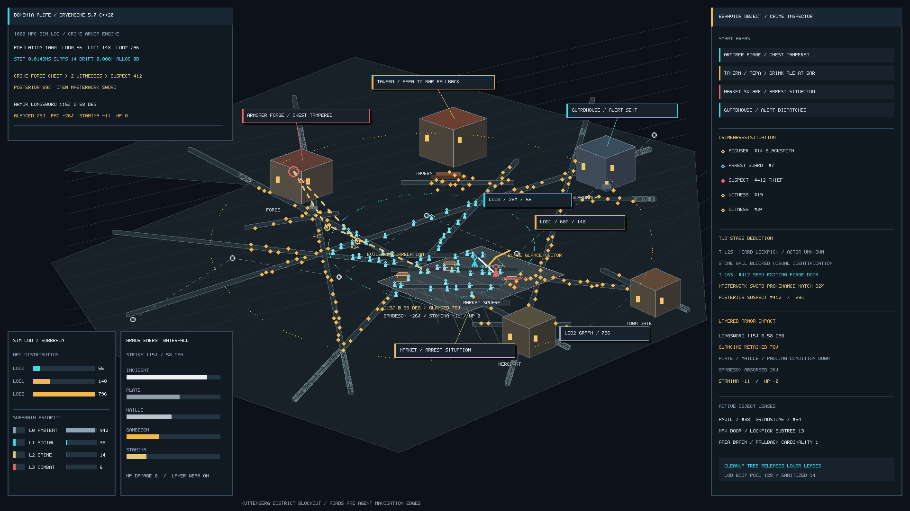

# BOHEMIA-ALIFE

An independent C++20 systems demo for simulating a medieval town population. It combines a fixed-capacity NPC simulation core, a native interactive Win32 viewer, deterministic behavior and evidence models, and source adapters for CRYENGINE 5.7.



## Run the live demo

The standalone viewer animates 1,000 NPCs over a shared eight-route town layout. It displays distance-based LOD, hydration rings, schedule and subbrain counts, crime evidence, tavern activity assignment, and armor impacts. It uses the Win32 API and GDI with an in-memory DIB framebuffer; no third-party runtime library is required.

From a Visual Studio x64 Developer PowerShell, the multi-config Visual Studio generator is:

```powershell
cmake -S . -B build -G "Visual Studio 17 2022" -A x64
cmake --build build --config Release --target BohemiaLiveSim
.\build\Release\BohemiaLiveSim.exe
```

This checkout was rebuilt with the Visual Studio 2026 C++ toolset using the NMake generator. In that setup, use a separate build directory:

```powershell
cmake -S . -B build-nmake -G "NMake Makefiles" -DCMAKE_BUILD_TYPE=Release
cmake --build build-nmake --target BohemiaLiveSim
.\build-nmake\Release\BohemiaLiveSim.exe
```

Controls:

| Input | Action |
| --- | --- |
| WASD or arrow keys | Move camera focus |
| Drag with left mouse button | Move camera focus |
| `1` | Trigger crime deduction scenario |
| `2` | Toggle Franta at the tavern |
| `3` | Apply a randomized armor strike |
| Space | Pause or resume |
| `+` / `-` | Change simulation speed |
| Esc | Close the viewer |

The target runs a frame loop capped near 60 FPS; this is a frame-rate target, not a claim that every machine sustains 60 FPS at all times.

## Build the showcase exporter

```powershell
cmake --build build --config Release --target BohemiaShowcaseExporter
.\build\Release\BohemiaShowcaseExporter.exe .
```

For the single-config NMake build above, use `cmake --build build-nmake --target BohemiaShowcaseExporter` and run `build-nmake\BohemiaShowcaseExporter.exe .`.

The exporter writes the local benchmark report to `docs/Bohemia-Benchmark-Results.md` and the image above to `docs/screenshots/bohemia-alife-showcase-1080p.png`. Benchmark values are machine-specific; regenerate them on the machine you want to report.

## What the project demonstrates

- Fixed-capacity, cache-line-aligned SoA simulation for up to 5,000 NPC records, with generation-checked body handles and a 128-slot hydrated-body pool.
- Three simulation LOD tiers with 28 m hydration and 32 m de-hydration hysteresis; the live viewer also displays a 60 m diagnostic range.
- A shared authored road-route graph used by the Win32 viewer and CRYENGINE adapter source.
- Bounded behavior-object registries, leases, cleanup on subbrain preemption, BDI intention commitment, schedule staggering, and time slicing.
- A two-stage crime-evidence example that combines wall-occluded audio, visible exit, and item provenance.
- A deterministic layered armor gameplay model with impact-energy accounting and condition wear.
- Ten focused CTest cases covering core behavior, including steady-state allocation instrumentation.

The simulation and combat values are portfolio-demo choices. The armor model is not a historical reconstruction or engineering tool. See [model boundaries and citations](docs/research-basis.md) and [implementation architecture](docs/implementation-architecture.md).

## CRYENGINE 5.7 integration status

`Code/Components/` contains Schematyc entity-component adapter source for the simulation, debug rendering, and primitive scene entities. `Game.cryproject` and a sample level are included. The standalone CMake build does not compile or link a CRYENGINE game plugin. `Game.cryproject` refers to `bin/win_x64/Game.dll`, but that binary is omitted from this repository; the local copy was only the engine template. The adapters are **not yet a verified runnable Sandbox game**. Linking and running them requires a compatible CRYENGINE 5.7 project build with the matching engine libraries. The standalone Win32 simulator is the working interactive demo and does not depend on that integration.

This is an independent portfolio project; it is not affiliated with or derived from any studio's proprietary game code.

## Authorship and reuse

Original source code in this repository authored by Michał Rusinek (Mr444-dev) is not offered under an open-source license; all rights are reserved. See [LICENSE](LICENSE). CRYENGINE, its SDK and template content, third-party dependencies and assets, and trademarks are excluded and remain under their own terms.
